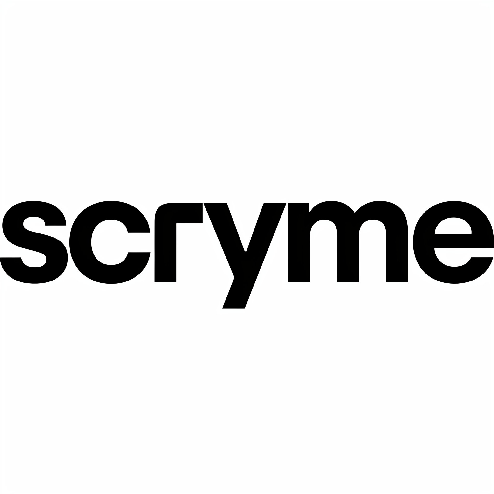

<div align="center">

# Scryme Enterprise ERP and Retail Operations Suite

**Multi-tenant retail, production, point of sale, and operations platform**

<p align="center">
  
</p>

[](https://github.com/larrybwosi/scryme/actions)
[](LICENSE)
[](https://nodejs.org/)
[](https://pnpm.io/)
[](https://www.typescriptlang.org/)
[](https://turbo.build/)
[](https://tauri.app/)

</div>

---

## Overview

Scryme is a TypeScript monorepo for retail and operations software. It includes web applications, backend services, desktop terminals, shared packages, and supporting tooling managed with pnpm workspaces and Turborepo.

For contribution workflow and local development expectations, see [CONTRIBUTING.md](CONTRIBUTING.md).

---

## Repository structure

### Applications (`apps/`)

- **[admin](./apps/admin)**: Administrative web application for system level operations.
- **[android](./apps/android)**: Android application workspace.
- **[api](./apps/api)**: NestJS backend API service.
- **[auth](./apps/auth)**: Authentication application workspace.
- **[bakery](./apps/bakery)**: Tauri desktop application for bakery and production workflows.
- **[cms](./apps/cms)**: Content management application workspace.
- **[crm](./apps/crm)**: CRM web application.
- **[docs](./apps/docs)**: Documentation application workspace.
- **[pos](./apps/pos)**: Tauri desktop point of sale application.
- **[projects](./apps/projects)**: Projects application workspace.
- **[site-next](./apps/site-next)**: Public site built with TanStack Start, Vite, React 19, and Sanity integrations.
- **[web](./apps/web)**: Main web back office application built with Next.js 16 and React 19.

### Packages (`packages/`)

- **[@repo/auth](./packages/auth)**: Shared authentication utilities and integrations.
- **[@repo/chat](./packages/chat)**: Shared chat and messaging integration package.
- **[@repo/config-eslint](./packages/config-eslint)**: Shared ESLint configuration.
- **[@repo/config-prettier](./packages/config-prettier)**: Shared Prettier configuration.
- **[@repo/config-typescript](./packages/config-typescript)**: Shared TypeScript configuration.
- **[create-app](./packages/create-app)**: CLI for bootstrapping Scryme powered applications.
- **[@repo/db](./packages/db)**: Prisma schema, migrations, and database tooling.
- **[@repo/documents](./packages/documents)**: Document and PDF rendering utilities.
- **[@repo/env](./packages/env)**: Shared environment variable handling.
- **[@repo/mcp-server](./packages/mcp-server)**: MCP server package.
- **[@scryme/sdk](./packages/sdk)**: TypeScript SDK package for Scryme APIs and clients.
- **[@repo/shared](./packages/shared)**: Shared utilities and common modules.
- **[@repo/ui](./packages/ui)**: Shared UI components and frontend primitives.

### Other important areas

- **[docs/specs](./docs/specs)**: Product and implementation specifications.
- **[skills](./skills)**: Agent skills for workflows such as scope, architecture, development, testing, and audit.
- **[CONTRIBUTING.md](CONTRIBUTING.md)**: Contribution and local development guide.
- **[AGENTS.md](AGENTS.md)**: Repository guidance for coding agents and contributors.

---

## Tech stack

- **Language and runtime**: TypeScript, Node.js 24+
- **Monorepo tooling**: pnpm workspaces, Turborepo
- **Backend**: NestJS
- **Web**: Next.js, TanStack Start, React 19, Tailwind CSS
- **Desktop**: Tauri v2
- **Data and integrations**: Prisma, PostgreSQL, Redis, RabbitMQ, Better Auth, Socket.io, RxJS

---

## Getting started

### Prerequisites

- **Node.js** 24 or newer
- **pnpm** 10.34.1
- **Docker** and **Docker Compose**
- **Rust toolchain** 1.77 or newer if you plan to build the Tauri desktop apps (`apps/pos`, `apps/bakery`)

### Local development

1. **Clone the repository**

   ```bash
   git clone https://github.com/larrybwosi/scryme.git
   cd scryme
   ```

2. **Install dependencies**

   ```bash
   pnpm install
   ```

3. **Start local infrastructure**

   ```bash
   docker compose -f docker-compose.dev.yml up -d
   ```

   (You can also run `pnpm run start:dev`.)

4. **Configure environment variables**

   ```bash
   cp .env.example .env
   cp apps/api/.env.example apps/api/.env
   ```

   Copy additional `.env` files as needed for the apps or packages you are working on.

5. **Prepare the database** (when required for your work)

   ```bash
   pnpm run db:migrate:dev
   pnpm run db:seed
   ```

6. **Build all packages before starting the dev server**

   ```bash
   pnpm build
   ```

7. **Start development servers**

   ```bash
   pnpm dev
   ```

To run a specific workspace:

```bash
pnpm --filter web dev
pnpm --filter api dev
pnpm --filter pos dev
```

---

## Common commands

```bash
# Install dependencies
pnpm install

# Build all packages and apps
pnpm build

# Start development servers
pnpm dev

# Lint
pnpm lint

# Format
pnpm format

# Run tests
pnpm test

# Generate artifacts
pnpm generate

# Database tasks
pnpm run db:migrate:dev
pnpm run db:seed
```

---

## Working with AI coding agents

If you are using an AI coding agent in this repository, use the relevant skills in [`skills/`](./skills) for the task and follow their instructions. Also read [`AGENTS.md`](AGENTS.md), any applicable workspace `AGENTS.md` files, and related specs in [`docs/specs/`](./docs/specs).

---

## Deployment

### Containerized deployment

Use the provided Compose files for container based environments, for example:

```bash
docker compose -f docker-compose.prod.yml up -d
```

### Desktop builds

To build desktop binaries for Tauri apps:

```bash
# POS
cd apps/pos
pnpm tauri build

# Bakery
cd ../bakery
pnpm tauri build
```

---

## Additional documentation

The `docs/` directory contains additional guides and references, including:

- [Customer Single Sign On and Authentication Guide](./docs/customer-authentication.md)
- [Connected Apps and V3 Catalog Architecture Guide](./docs/v3-connected-apps-catalog.md)
- [Admin App Deployment and Database Guide](./docs/admin-deployment.md)
- [Multi Instance and Shared Infrastructure Deployment Guide](./docs/multi-instance-deployment.md)
- [Secure Prisma Studio Containerization Guide](./docs/prisma-studio-deployment.md)

---

## License

This repository is licensed under the **GNU Affero General Public License version 3 (AGPL-3.0)**. See [LICENSE](LICENSE) for details.
